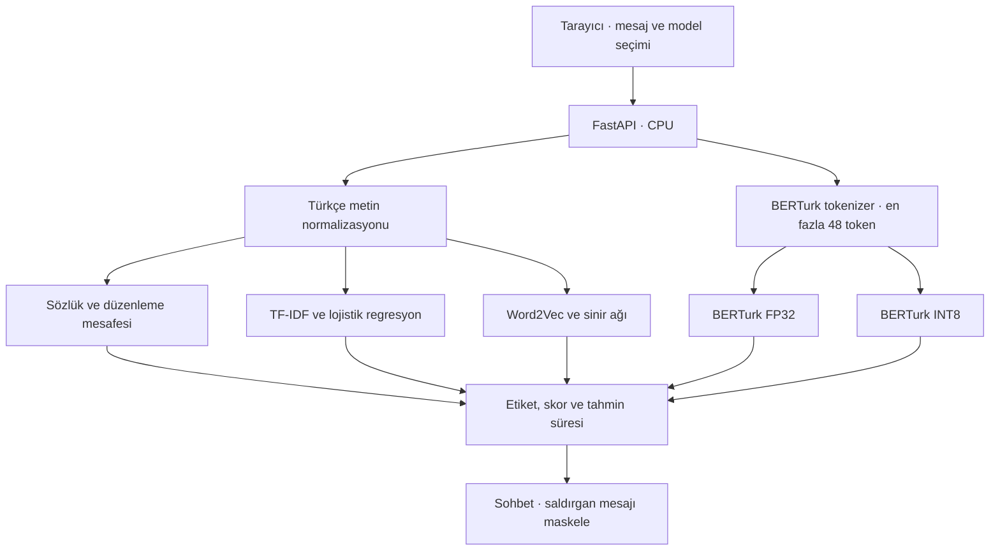

# Türkçe sohbet moderasyonu · SWE015

Türkçe sohbet mesajlarını beş yöntemle karşılaştıran SWE015 uygulaması. Tam kurulumda varsayılan model, saldırgan dil tespiti için ince ayar yapılmış BERTurk’ün INT8 sürümüdür. Kullanıcı modeli değiştirebilir. Saldırgan olarak işaretlenen mesaj maskelenir. Yan panelde mesaj başına CPU tahmin süresi ve tarayıcının yanıtı beklediği toplam süre gösterilir.

## Mac’te demoyu açma

Python 3.12 ve özel depoya erişimi olan bir GitHub hesabı gerekir. Ağırlıkları indirmek için GitHub CLI’ı (`gh`) aynı hesapla kullanın. Depoyu daha önce klonladıysanız proje klasöründe `git pull --ff-only` çalıştırarak ilk iki komutu atlayabilirsiniz.

```bash
git clone https://github.com/MuhammedSaidTosun/swe015-turkce-moderasyon.git
cd swe015-turkce-moderasyon
python3.12 -m venv .venv
source .venv/bin/activate
python -m pip install -r requirements-bert.txt
gh release download berturk-moderasyon-v1 --pattern berturk-models.zip --dir artifacts --skip-existing
python -m zipfile -e artifacts/berturk-models.zip artifacts
python -m uvicorn app:app
```

Tarayıcıda [yerel uygulamayı açın](http://127.0.0.1:8000). Açılır menüde **BERTurk · INT8** seçili olarak gelir. Eski sunucu aynı portu kullanıyorsa o Terminal penceresinde Ctrl+C ile durdurun veya yeni sunucuyu `python -m uvicorn app:app --port 8001` ile başlatıp `http://127.0.0.1:8001` adresini açın. Üç küçük modelin dosyaları klonla birlikte gelir. İki BERTurk modelini içeren sürüm paketi ayrıca indirilir. [Model paketinin sürüm sayfası](https://github.com/MuhammedSaidTosun/swe015-turkce-moderasyon/releases/tag/berturk-moderasyon-v1)

## Beş modelin aynı test kümesindeki sonucu

OffensEval-TR resmî test kümesindeki 3.528 mesajın 716’sı saldırgan, 2.812’si normal olarak etiketlendi. Makro F1, her iki sınıfın F1 puanına eşit ağırlık verir. Gecikme için önceden belirlenen hedef, CPU’da tek bir mesajı ortalama 50 ms içinde sınıflandırmaktı.

| Model | Test makro F1 | Model boyutu (MB) | Ortalama CPU (ms) | Yakalanan saldırgan mesaj (/716) | Yanlış alarm (/2.812) |
|---|---:|---:|---:|---:|---:|
| Sözlük + düzenleme mesafesi | 0,5340 | 0,000588 | 0,052 | 70 | 18 |
| TF-IDF + lojistik regresyon | 0,7214 | 1,028 | 0,189 | 422 | 365 |
| Word2Vec + sinir ağı | 0,6330 | 5,413 | 0,031 | 305 | 439 |
| BERTurk FP32 · PyTorch | 0,7817 | 443,31 | 13,876 | 421 | 170 |
| **BERTurk INT8 · ONNX Runtime** | **0,7838** | **112,55** | **9,009** | **420** | **162** |

Ölçümler Apple M4’te tek CPU iş parçacığıyla yapıldı. On ısınma çağrısından sonra her modele aynı sırada 200 mesaj, tek tek verildi. Süre metin ön işlemeyi ve model tahminini kapsar. Tarayıcı ve ağ süreleri ayrıca uygulamada görüntülenir. BERTurk boyutları ağırlıkları, tokenizer’ı ve yapılandırmayı kapsar. [Tam CSV](results/five_model_test.csv) · [Ortam, ölçüm protokolü ve dosya özetleri](results/five_model_test.json)

INT8 paketi FP32’ye göre %74,6 daha küçük. INT8 tahminlerinin 95. yüzdeliği 15,33 ms, en yavaş tahmin 16,51 ms idi. Bu 200 ölçümde 50 ms’yi aşan tahmin olmadı. İlk PyTorch INT8 denemesi ise aynı cihazda ortalama 55,83 ms sürdü. Son sürümde çıkarım motoru da değişti. Etkiyi aynı motorla kontrol ettiğimizde ONNX Runtime, doğrulamadan seçilen aynı 200 mesajda FP32 için 12,09 ms, INT8 için 9,25 ms verdi. [İlk INT8 ölçümü](results/five_model_test_1thread.csv) · [Aynı çıkarım motoruyla karşılaştırma](results/ort_paired_validation.json)

## Sohbette denenebilecek üç mesaj

Varsayılan BERTurk INT8 modelinin gerçek API çıktıları aşağıdadır. Karar eşiği %62. Sohbet ekranında seçili sınıfa güven ile saldırganlık olasılığının ayrı anlamları vardır.

| Yazılan mesaj | Saldırganlık olasılığı | Ekrandaki sonuç |
|---|---:|---|
| Herkese iyi oyunlar! | %2,95 | Mesaj görünür. |
| Sen bir aptalsın. | %94,85 | Mesaj maskelenir. |
| Ona aptal demen hiç hoş değil. | %65,01 | Mesaj maskelenir. Hakareti eleştiren bir kullanıcı için bu bir yanlış alarmdır. |

Son cümleyi TF-IDF ile tekrar gönderin. TF-IDF cümleyi normal sayar. Bu örnekler canlı demo için yazıldı. Test puanları resmî veri kümesinden hesaplandı.

## Eğitimi ve ölçümü tekrarlama

Aynı Python ortamında, proje klasöründen çalıştırın. Veri hazırlama adımı ilk çalıştırmada internet erişimi gerektirir.

```bash
python data_prep.py
python train_classical.py
python train_neural.py
python train_bert.py
python evaluate_all.py
```

Eğitim, TF-IDF sözlüğünü eğitim mesajlarından çıkarır. Lojistik regresyonun `C` değerini doğrulama kümesindeki macro-F1 ile seçer. `data/processed/test.csv` tüm modeller için ortak test dosyasıdır. Model veya eşik geliştirirken `python train_classical.py --eval-split validation` kullanın.

Word2Vec, eğitim mesajlarında bir kelimenin sağındaki ve solundaki en fazla üçer kelimeden ortadaki kelimeyi tahmin etmeyi öğrenir (CBOW, beş negatif örnek). En az iki kez görülen kelimeler 48 boyutlu vektörlerle temsil edilir. Sınıflandırıcı bir mesajdaki bilinen kelimelerin vektörlerini ortalar, eğitim kümesinin istatistikleriyle standartlaştırır ve 64 ReLU nöronundan geçirir. Sinir ağı mini-batch SGD ve geri yayılımla eğitilir. Eğitim turu ve karar eşiği doğrulama macro-F1 değerine göre seçilir. `results/neural_training.json` eğitim kaydını içerir.

BERTurk için başlangıç noktası, `dbmdz/bert-base-turkish-cased` modelinin `b6e1de16c983e0f2c70664591ea3f22810072608` sürümüdür. Büyük ve küçük harf korunur. Eğitim maliyetini Mac CPU’suna uygun tutmak için sabit tohumla sınıf oranlarını koruyan 12.288 eğitim örneği kullanılır. On iki encoder bloğunun tamamı çıkarımda çalışır. Eğitim sırasında kelime gömmeleri ve ilk on blok sabittir. Son iki blok, pooler ve iki sınıflı çıkış katmanı güncellenir. İki tur boyunca en fazla 48 token, 24 mesajlık batch ve AdamW ile 0,00004 öğrenme hızı kullanılır. Tur ve sınıflandırma eşiği, 3.174 doğrulama mesajında macro-F1 ile seçilir. İkinci tur doğrulamada 0,79195 macro-F1 ile seçildi. FP32 ve INT8 aynı 0,62 karar eşiğini kullanır. Tam eğitim, doğrulama ve ilk dışa aktarma Apple M4 CPU üzerinde 350 saniye sürdü. Dağıtılan INT8 sürümünde ONNX Runtime kullanılır. Doğrusal katmanların ağırlıkları kanal başına işaretli INT8 olarak, üç gömme tablosu ise tablo başına işaretsiz 8 bit olarak saklanır. Dinamik giriş kuantizasyonu çalışma sırasında yapılır. [BERTurk model kartı](https://huggingface.co/dbmdz/bert-base-turkish-cased)

## Uygulamada veri akışı



| Ödevdeki teknik alan | Uygulamadaki karşılığı |
|---|---|
| A · Sinir ağları | Eğitim mesajlarından öğrenilen Word2Vec vektörleri ve 64 gizli nöronlu sınıflandırıcı. |
| B · Klasik NLP | Türkçe metin normalizasyonu, düzenleme mesafeli sözlük ve TF-IDF + lojistik regresyon. |
| C · Transformer | Türkçe WordPiece tokenizer ve iki sınıflı görev için ince ayarlı, 12 katmanlı BERTurk. |
| D · Verimli modeller | Seçilen BERTurk modelinin INT8’e dönüştürülmesi, CPU ölçümü ve sohbet ekranında çalıştırılması. |

## Veri bölümü ve sınırlamalar

Kaynak eğitim bölümünde 31.756 mesaj vardı. Boşluk ve Unicode normalizasyonuyla saptanan dokuz tekrar ile resmî testte de bulunan iki eğitim kaydı çıkarıldı. Sınıf oranları korunarak 28.571 eğitim ve 3.174 doğrulama mesajı ayrıldı. Resmî test kümesindeki 3.528 mesajın tamamı korundu. İlk çalıştırmada kaynaklar OffensEval dağıtımının bir aynasından alındı. `data_prep.py` varsayılan olarak yazarın sunduğu ZIP’i indirir. Yerel arşivle çalışmak için `python data_prep.py --archive offenseval2020-turkish.zip` kullanılabilir. [Kullanılan ayna](https://github.com/vidhur2k/Multilngual-Hate-Speech)

Word2Vec 29.211 kelime için vektör öğrendi. Sinir ağının 19. eğitim turu ve 0,46 eşiği doğrulamada seçildi. Kelime vektörlerini ortalamak sözcük sırasını kaybettirir. BERTurk bağlamı kullanabiliyor, ancak canlı örnekte görüldüğü gibi eleştiri ve hakareti karıştırabiliyor. Test kümesi Twitter mesajlarından oluşuyor. Oyun sohbetlerinde başarımı ölçmek için o alandan etiketli bir test kümesi gerekir.

## İki dakikalık demo akışı

| Zaman | Ekranda gösterilecek işlem |
|---|---|
| 0:00–0:15 | Sohbeti açın. INT8’in seçili olduğunu ve CPU hedefinin 50 ms olduğunu gösterin. |
| 0:15–0:45 | Normal mesajı ve doğrudan hakareti sırayla gönderin. Maskeleme, saldırganlık olasılığı ve süre kaydını gösterin. |
| 0:45–1:15 | “Ona aptal demen hiç hoş değil.” mesajını önce INT8, sonra TF-IDF ile gönderin. Yanlış alarmın kullanıcıya etkisini açıklayın. |
| 1:15–1:45 | Beş modelin tablosunu açın. INT8’in boyutunu, ortalama süresini ve yakaladığı 420 saldırgan mesajı gösterin. |
| 1:45–1:55 | Test verisinin kaynağını ve oyun sohbetlerine genelleme sınırlamasını söyleyin. |

Teslim için 8–12 slaytlık PDF ve sesli ekran kaydı hazırlanır. İlk slayta depo ve video bağlantıları eklenir. Depo özel olduğundan, teslimden önce değerlendirecek kişinin erişimini doğrulayın.

## Veri ve atıf

Çağrı Çöltekin (2020), *A Corpus of Turkish Offensive Language on Social Media*. Bu projede OffensEval 2020 Türkçe alt görev A kullanılır. Etiketler `0 = NOT` ve `1 = OFF` olarak kodlanır. [Yazarın veri sayfası](https://coltekin.github.io/offensive-turkish/) · [Makale](https://aclanthology.org/2020.lrec-1.758/)
